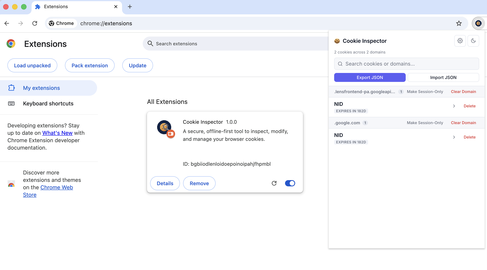
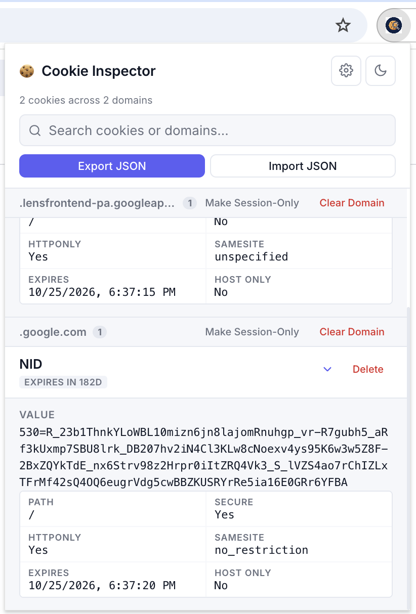
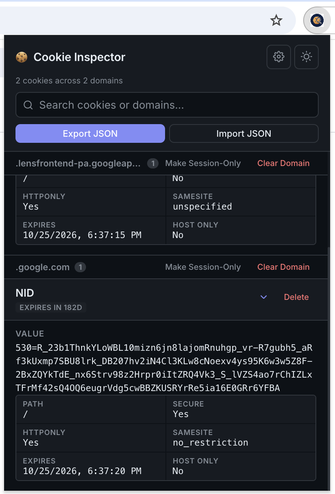
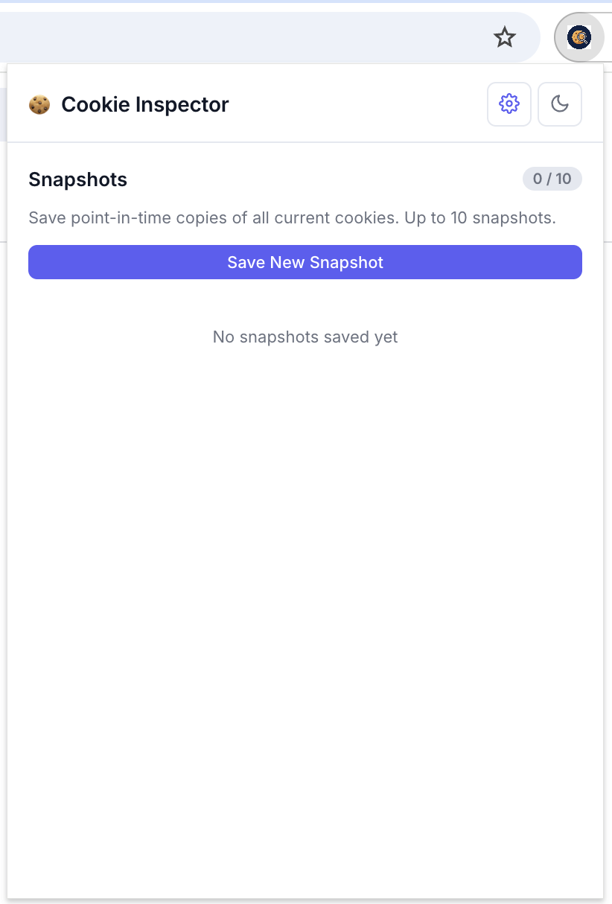
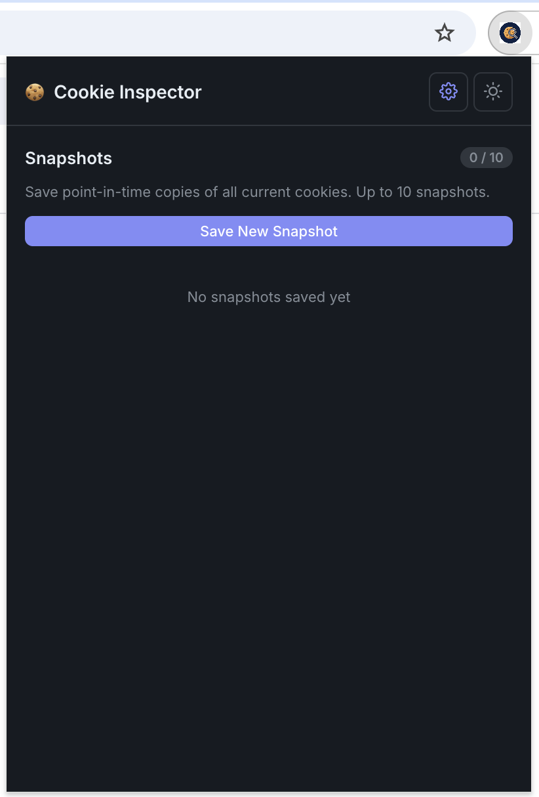
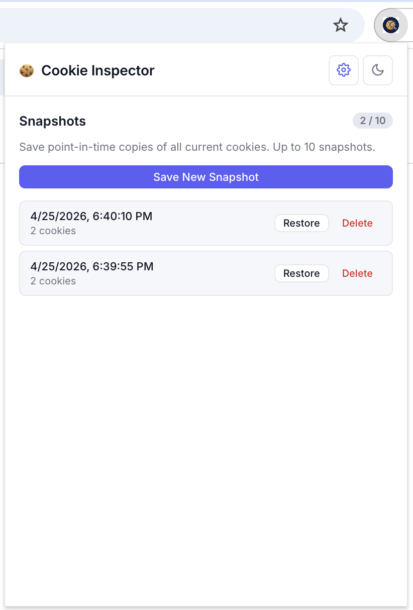
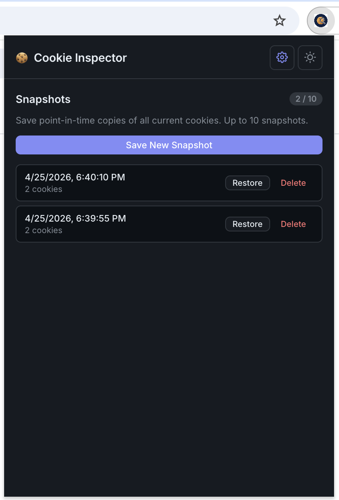

# 🍪 Cookie Inspector

A clean, offline-first Chrome extension for inspecting, decoding, and managing browser cookies — with dark mode, live updates, snapshots, and import/export.

> **[Install from the Chrome Web Store](https://chromewebstore.google.com/detail/cookie-inspector/hlkphfjopipfemagmodglbccjgbmhjkm)**

---

## Screenshots



**Cookie Inspector — Main View**
View and search all cookies grouped by domain, with security indicators and expandable detail panels.

<table>
  <tr>
    <td align="center"><strong>Light Mode</strong></td>
    <td align="center"><strong>Dark Mode</strong></td>
  </tr>
  <tr>
    <td></td>
    <td></td>
  </tr>
</table>

**Snapshots**
Save up to 10 point-in-time copies of your cookies and restore them at any time.

<table>
  <tr>
    <td align="center"><strong>Light Mode</strong></td>
    <td align="center"><strong>Dark Mode</strong></td>
  </tr>
  <tr>
    <td></td>
    <td></td>
  </tr>
</table>

**Snapshot Management**
Manage your saved snapshots — view when each was taken, how many cookies it contains, and restore or delete with one click.

<table>
  <tr>
    <td align="center"><strong>Light Mode</strong></td>
    <td align="center"><strong>Dark Mode</strong></td>
  </tr>
  <tr>
    <td></td>
    <td></td>
  </tr>
</table>

---

## Features

### Cookie Inspection

View every cookie stored in your browser, grouped by domain. A stats bar shows the total count and number of domains at a glance. The list updates in real time as websites set or remove cookies while the popup is open — no need to close and reopen.

### Cookie Detail Panel

Expand any cookie with the chevron to reveal its full metadata — raw value, path, secure flag, HttpOnly, SameSite policy, expiration date, and host-only status. If the cookie value is JSON or Base64 encoded, the decoded output is shown automatically.

### Cookie Creation & Editing

- **Manual form** — create a cookie field-by-field with full control over every attribute
- **JSON / Base64 paste** — paste a cookie object, an array of cookies, or Base64-encoded JSON to create one or many cookies at once
- **Inline editing** — expand any cookie and click Edit to modify its fields directly in the detail panel

### This Site / All Sites

When the active tab is a website, the list opens on **This site**: only the cookies that apply to that hostname (domain cookies for it or a parent domain, and host-only cookies for that exact host). Switch to **All sites** for every cookie in the browser. On tabs with no site (a new tab, `chrome://` pages) the toggle is hidden and everything is shown. Search, filters, stats and **Export JSON** all follow the selected scope.

### Filtering & Sorting

Filter the cookie list by attribute using quick-select chips:

- **All** — show everything
- **Session** — cookies with no expiration date
- **No HttpOnly** — cookies accessible to JavaScript (potential XSS risk)
- **Insecure** — cookies without the Secure flag
- **Duplicate** — cookies whose name appears on more than one domain (within the selected scope)

Sort domain groups by: **Domain A–Z**, **Name A–Z**, **Expiry**, or **Cookie Count**.

### Security Indicators

- Cookies missing the `HttpOnly` flag show a **No HttpOnly** label with an amber left border
- Cookies whose name appears on multiple domains show a **Duplicate** label
- The **Insecure** filter surfaces cookies missing the Secure flag

### Domain Pinning

Pin any domain to keep it anchored at the top of the list, regardless of the active sort order. Pin state is saved across sessions.

### Cookie Management

- **Delete** — remove any individual cookie instantly
- **Clear Domain** — bulk delete all cookies for a domain in one click
- **Make Session-Only** — strip expiration dates from all cookies under a domain

### Snapshots

Save up to 10 named, point-in-time copies of all your cookies. Each snapshot records when it was taken and how many cookies it contains. Restore any snapshot to bring your cookies back to that state, or delete ones you no longer need.

### Export & Import

Export the cookies in the current scope (one site, or all sites) to a timestamped JSON file for backup or transfer. Import a previously exported file to restore cookies across sessions or devices.

### Dark Mode

Automatically respects your system's dark/light preference. Toggle manually at any time using the theme button in the header — your preference is saved across sessions.

### Privacy First

Cookie Inspector is entirely offline. No data is ever collected, transmitted, or shared. All storage is local to your browser.

---

## Installation

### From the Chrome Web Store

[Cookie Inspector on the Chrome Web Store](https://chromewebstore.google.com/detail/cookie-inspector/hlkphfjopipfemagmodglbccjgbmhjkm)

### Manual (Developer Mode)

1. Clone or download this repository
2. Open Chrome and go to `chrome://extensions/`
3. Enable **Developer mode** (top right toggle)
4. Click **Load unpacked** and select the project folder

---

## Development

No build step required. Edit the source files directly and click the refresh icon on the extension card in `chrome://extensions/` to reload.

```
cookie_inspector/
├── manifest.json         # Extension config and permissions
├── cookieEditor.html     # Popup UI
├── cookieEditor.js       # All application logic
├── cookieEditor.css      # Styles and theme tokens
├── fonts/                # Bundled Inter font (Latin subset) and its license
├── privacy-policy.html   # GitHub Pages privacy policy
├── tests/                # End-to-end tests (Playwright), decoder and site-scope unit tests
├── screenshots/          # Screenshots used in this README
└── icons/                # Extension icons (16px, 32px, 48px, 128px)
```

### Tests

The tests run the real popup as an extension in Chromium, against real cookies. They are development tooling only: the extension itself has no dependencies and no build step.

```bash
npm install
npx playwright install chromium
npm test                # decoder and site-scope unit tests, then end-to-end tests
```

Run `npm run test:decode`, `npm run test:scope` or `npm run test:e2e` on their own, and set `HEADED=1` to watch the browser.

### Packaging

`package.json`, `tests/` and `node_modules/` are not part of the extension. When zipping it for the Chrome Web Store, include only `manifest.json`, `cookieEditor.html`, `cookieEditor.css`, `cookieEditor.js`, `fonts/` and `icons/`.

---

## License

MIT

---

<p align="center">
  Built by <a href="https://github.com/joshuaerney">@joshuaerney</a>
</p>
