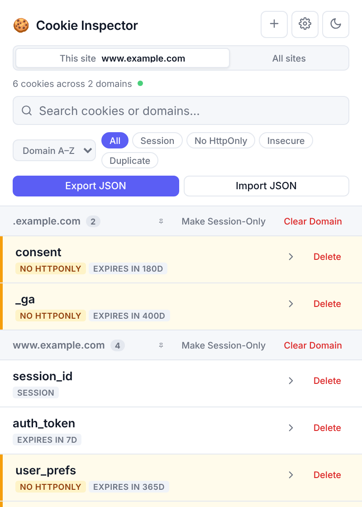
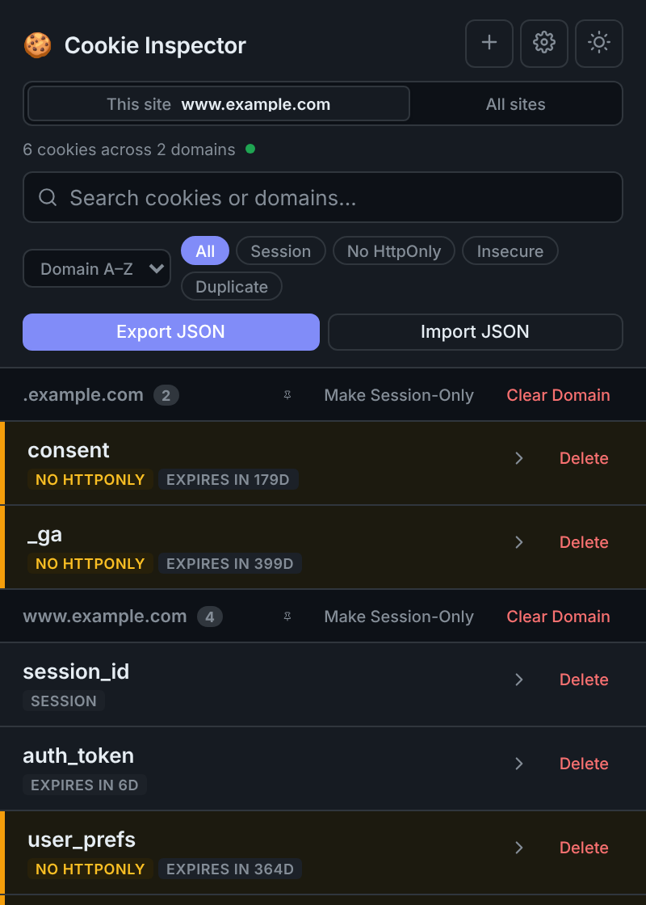
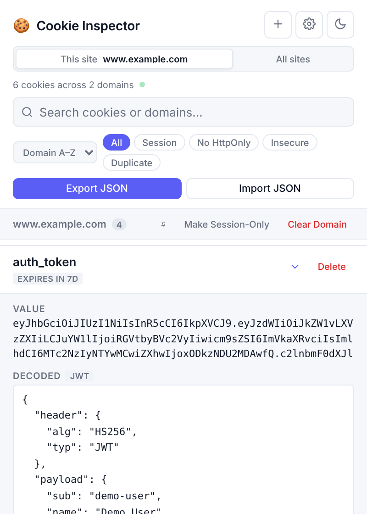
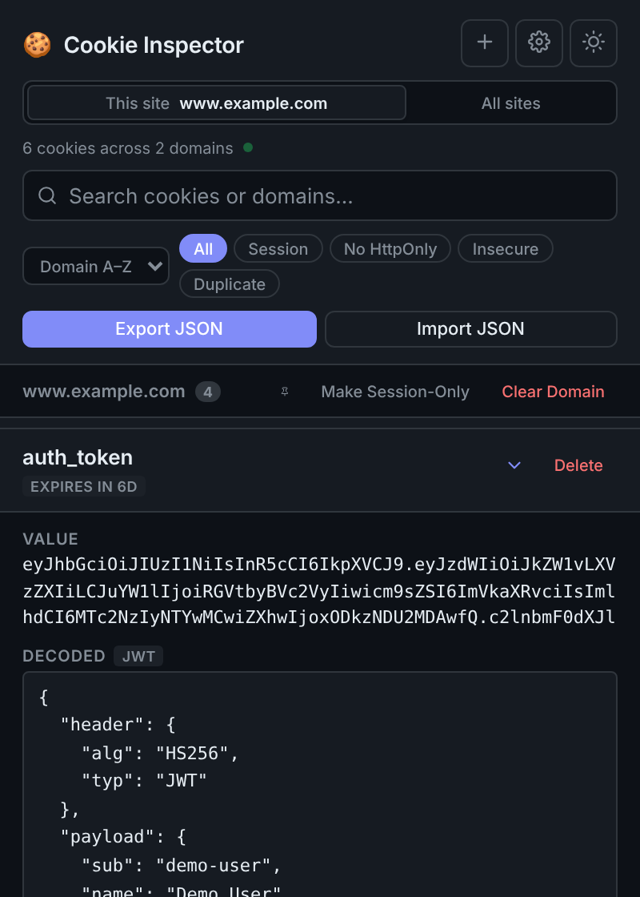
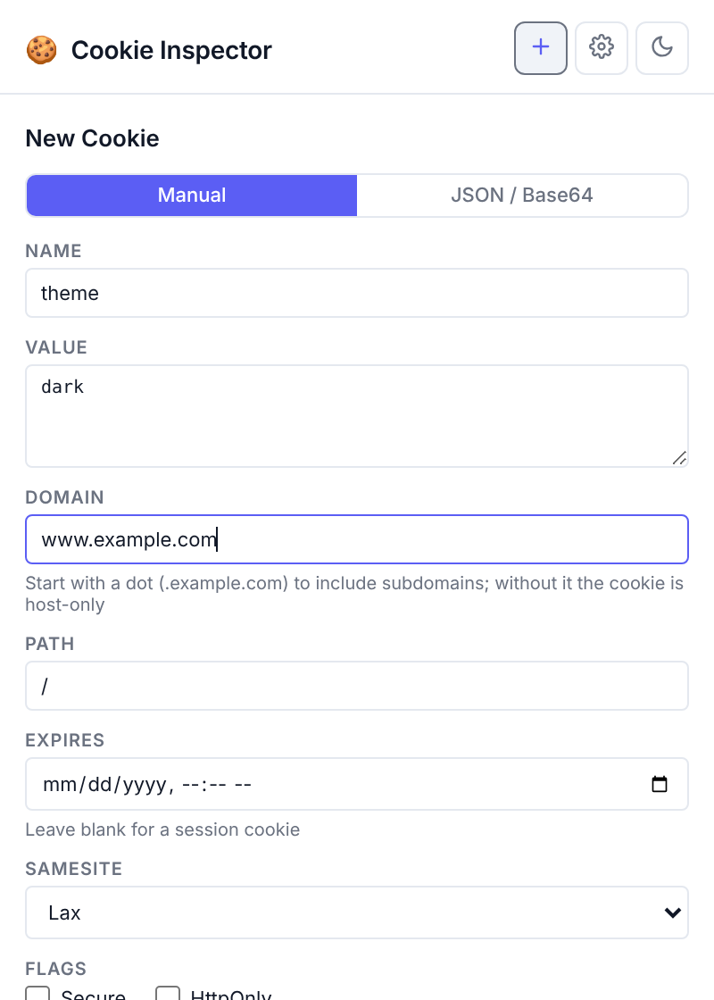
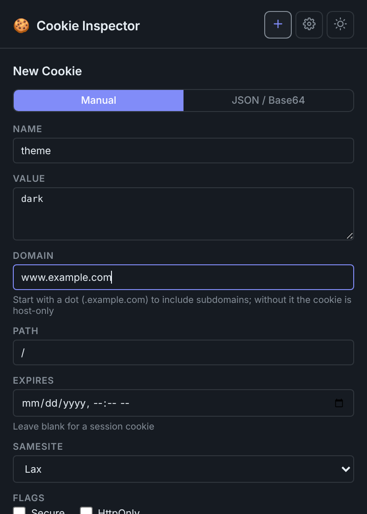
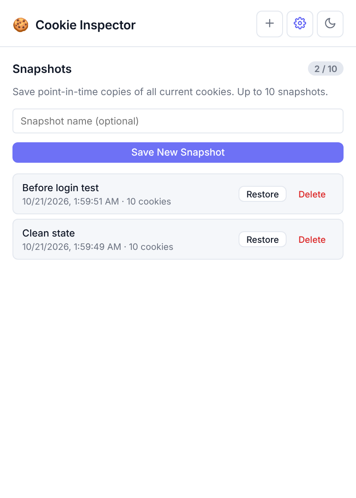
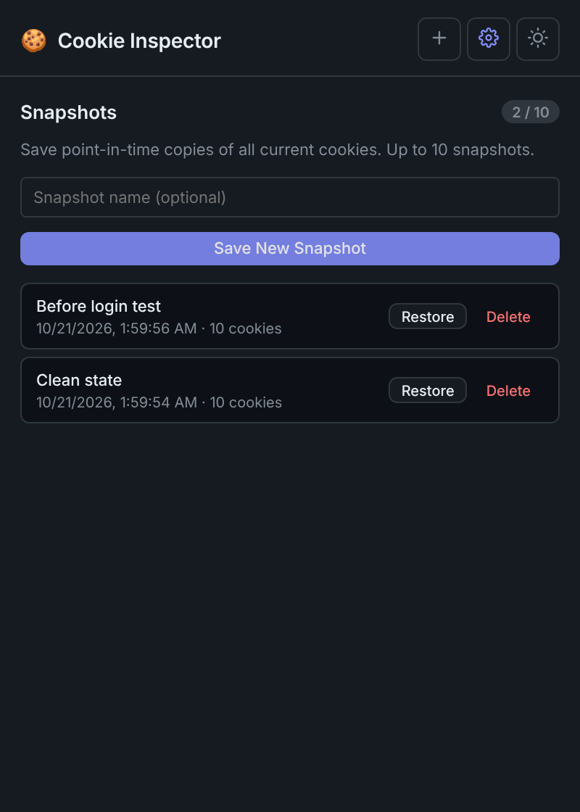

# 🍪 Cookie Inspector

A clean, offline-first Chrome extension for inspecting, decoding, editing, and managing browser cookies. It opens on the site you are looking at, decodes JSON, JWT, URL-encoded and Base64 values for you, and keeps everything on your device.

> **[Install from the Chrome Web Store](https://chromewebstore.google.com/detail/cookie-inspector/hlkphfjopipfemagmodglbccjgbmhjkm)**

<table>
  <tr>
    <td align="center"><strong>Light mode</strong></td>
    <td align="center"><strong>Dark mode</strong></td>
  </tr>
  <tr>
    <td></td>
    <td></td>
  </tr>
</table>

---

## Quick start

1. Install Cookie Inspector from the [Chrome Web Store](https://chromewebstore.google.com/detail/cookie-inspector/hlkphfjopipfemagmodglbccjgbmhjkm), or load it manually (see [Installation](#installation)).
2. Pin it: click the puzzle-piece icon in Chrome's toolbar, then the pin next to Cookie Inspector.
3. Open any website and click the Cookie Inspector icon. It opens on that site's cookies. Click **All sites** to see every cookie in the browser.

---

## Using Cookie Inspector

### The main window

| Control | What it does |
| --- | --- |
| **+** (header) | Opens the New Cookie panel. |
| **Gear** (header) | Opens the Snapshots panel. |
| **Moon / sun** (header) | Switches between dark and light mode. |
| **This site / All sites** | Chooses which cookies are listed. Hidden when the current tab is not a website. |
| Stats line and green dot | Shows how many cookies and domains are listed. The pulsing dot means the list is updating live. |
| **Search** | Filters the list by cookie name, domain or value. |
| **Sort** menu | Orders the domain groups. |
| **Filter chips** | Narrows the list to one kind of cookie. |
| **Export JSON / Import JSON** | Saves cookies to a file, or loads them from one. |
| Domain headers | Pin a domain, make its cookies session-only, or clear it. |
| Cookie rows | Expand for details, or delete. |

Cookies are grouped by their domain exactly as Chrome stores it, so `.example.com` (a domain cookie) and `www.example.com` (a host-only cookie) are separate groups.

### Choosing what you see

#### This site / All sites

When the active tab is a website, Cookie Inspector opens on **This site** and lists only the cookies that tab can use:

- A **domain cookie** (a domain that starts with a dot, such as `.example.com`) applies to that host and all of its subdomains. On `www.example.com` it is shown.
- A **host-only cookie** (no leading dot) applies to that exact host only. On `www.example.com`, a host-only cookie for `example.com` or `api.example.com` is not shown.
- Cookies for other sites are not shown.

Click **All sites** to list everything. On tabs that are not websites (a new tab, `chrome://` pages, local files) the toggle is hidden and everything is listed. Each time you open the popup it starts on This site.

Search, filters, the stats line and **Export JSON** all follow the selected scope. If a search finds nothing in This site, the empty message has a **Show all sites** button.

#### Search

Type in the search box to match a cookie's **name**, **domain** or **value** (not case-sensitive). Search works within the selected scope and together with the filter chips.

#### Filter chips

| Chip | Shows |
| --- | --- |
| **All** | Everything in the scope. |
| **Session** | Cookies with no expiration date (they end when the browser session ends). |
| **No HttpOnly** | Cookies that page JavaScript can read. This is normal for many harmless cookies, such as preferences, but a session or login cookie that appears here is worth a second look. |
| **Insecure** | Cookies without the Secure flag, which can be sent over plain `http://`. |
| **Duplicate** | Cookies whose name exists on more than one domain within the scope. In **This site** that means the same name set on, say, both `.example.com` and `www.example.com`, which is a common cause of "wrong value" bugs. |

#### Sort

**Domain A–Z**, **Name A–Z**, **Expiry** (soonest first) or **Count** (domains with the most cookies first). Pinned domains always stay at the top.

### Reading a cookie

Each row shows the cookie name and small labels:

- **No HttpOnly** (with an amber bar on the left): the cookie is readable by page JavaScript.
- **Duplicate**: the name also exists on another domain in the scope.
- **Partitioned**: a partitioned (CHIPS) cookie, which a site sets separately for each top-level site it is embedded in.
- **Session**, **Expires in 12d**, **Expires in 5h**, **Expires soon** (under an hour) or **Expired**.

Click the **chevron** on a row to open its details: the raw value, then **Path**, **Secure**, **HttpOnly**, **SameSite**, **Expires** (as a full date and time), **Host Only**, and the **Partition** for partitioned cookies.

#### Automatic decoding

If a value can be decoded, a **Decoded** box appears under it with a label for what was found:

| Label | Meaning |
| --- | --- |
| **JSON** | The value is a JSON object or array, shown pretty-printed. |
| **JWT** | A JSON Web Token. The header and payload are shown, and `iat`, `nbf` and `exp` are converted to dates. Cookie Inspector does **not** check the signature, and says so. |
| **URL-encoded** / **URL-encoded JSON** | Percent-encoded text (`%7B%22a%22%3A1%7D`), decoded, and as JSON if it parses. |
| **Base64** / **Base64 JSON** | Base64 or Base64url that decodes to readable UTF-8 text, and as JSON if it parses. |

Plain values such as `123`, `true` or a random token are left alone rather than mislabelled.

<table>
  <tr>
    <td align="center"><strong>Light mode</strong></td>
    <td align="center"><strong>Dark mode</strong></td>
  </tr>
  <tr>
    <td></td>
    <td></td>
  </tr>
</table>

### Creating a cookie

Click **+** in the header. There are two ways to make a cookie.

**Manual** has one field per attribute:

| Field | Notes |
| --- | --- |
| **Name** | Required. |
| **Value** | Any text. Chrome rejects some characters, such as `;`. |
| **Domain** | Required. Start with a dot (`.example.com`) for a domain cookie that includes subdomains. Without a dot (`www.example.com`, `localhost`, `127.0.0.1`) it is host-only. |
| **Path** | Defaults to `/`. Must start with `/`. |
| **Expires** | Your local date and time. Leave it blank for a session cookie. |
| **SameSite** | Lax (default), Strict, None or Unspecified. |
| **Flags** | **Secure** and **HttpOnly**. |

Before sending anything to Chrome, Cookie Inspector checks the usual rules and tells you what is wrong: a missing name or domain, a domain that is not a hostname, a path that does not start with `/`, `SameSite=None` without Secure, and the `__Secure-` and `__Host-` prefix rules.

**JSON / Base64** creates one or many cookies from text. Paste a single cookie object, an array of cookies, or the Base64 of either. Every cookie needs at least a `name` and a `domain`:

```json
[
  { "name": "theme", "value": "dark", "domain": "www.example.com" },
  { "name": "lang", "value": "en", "domain": ".example.com", "path": "/", "secure": true, "sameSite": "lax" }
]
```

A missing `path` becomes `/` and a missing `sameSite` becomes `lax`. This is the same format **Export JSON** produces. If Chrome rejects some of the cookies, the message says how many were created and how many were rejected.

<table>
  <tr>
    <td align="center"><strong>Light mode</strong></td>
    <td align="center"><strong>Dark mode</strong></td>
  </tr>
  <tr>
    <td></td>
    <td></td>
  </tr>
</table>

### Editing a cookie

1. Click the chevron on a cookie, then **Edit Cookie**.
2. Change any field and click **Save Changes** (or **Cancel**).

The new cookie is written first. If you changed the name, domain or path, that makes it a different cookie, so the original is removed afterwards. If Chrome rejects the change, the original is left exactly as it was and the message says why. While an edit form is open, live updates do not redraw the list, so your typing is never lost.

### Deleting and bulk actions

- **Delete** removes one cookie immediately.
- **Clear Domain** removes **every** cookie stored for that domain (the exact domain shown in the group header), immediately and without asking. That includes cookies hidden by a search or filter, so the number on the group can be smaller than what gets deleted.
- **Make Session-Only** removes the expiration date from all of that domain's persistent cookies. They then behave as session cookies. Whether they disappear when you close Chrome depends on Chrome's startup setting: with "Continue where you left off", Chrome keeps session cookies.

There is no undo for any of these. Take a [snapshot](#snapshots) or an [export](#export-and-import) first if you might want the cookies back.

### Pinning domains

Click the **pin** icon in a domain's header to keep that domain at the top of the list, whatever the sort order. Pins are remembered between sessions. Pinned domains that are outside the current scope are not shown.

### Snapshots

A snapshot is a saved copy of your cookies at one moment.

1. Click the **gear** in the header.
2. Optionally type a name (up to 40 characters), then click **Save New Snapshot**.
3. Each saved snapshot lists its name, date and cookie count, with **Restore** and **Delete** buttons.

Things to know:

- You can keep **10** snapshots. The counter in the panel shows how many are used, and saving is disabled at 10.
- A snapshot always contains **every cookie in the browser**, not just the site you are viewing.
- **Restore** sets every cookie from the snapshot again, overwriting any current cookie with the same name, domain and path. It does **not** delete cookies that were created after the snapshot, so it brings cookies back but is not a full rollback. The message tells you how many were restored and how many Chrome rejected.
- Snapshots are stored in your browser profile, and they hold live session cookies, so treat them like the cookies themselves. If browser storage is full, saving fails with a clear message: delete an older snapshot and try again.

<table>
  <tr>
    <td align="center"><strong>Light mode</strong></td>
    <td align="center"><strong>Dark mode</strong></td>
  </tr>
  <tr>
    <td></td>
    <td></td>
  </tr>
</table>

### Export and import

**Export JSON** downloads the cookies in the current scope (one site, or all sites) as `cookies_YYYY-MM-DD.json`. In **This site** the file name includes the hostname. Search and filters are ignored, so you always get the whole scope. The file is an array of cookie objects:

```json
[
  {
    "name": "consent",
    "value": "accepted",
    "domain": ".example.com",
    "path": "/",
    "secure": false,
    "httpOnly": false,
    "sameSite": "unspecified",
    "expirationDate": 1893456000
  }
]
```

Chrome also adds `hostOnly`, `session` and `storeId`. They are ignored on import, because host-only is decided by the leading dot in `domain`.

**Import JSON** reads a file in that format and sets every cookie in it, overwriting any with the same name, domain and path. It does not ask for confirmation, and if Chrome rejects some cookies the message says how many were imported and how many were rejected. `sameSite` can be `no_restriction` (or `none`), `lax`, `strict` or `unspecified`.

Exported files contain live session tokens. Keep them private and delete them when you are done.

### Dark mode

Cookie Inspector follows your system's light or dark setting. Click the moon or sun in the header to switch; your choice is remembered.

---

## Privacy and permissions

Cookie Inspector is entirely offline. It collects, sends and shares nothing, has no analytics, and makes no network requests (an automated test checks this, and the Inter font is bundled in the extension). Everything is stored locally in your browser. The full text is in the [privacy policy](https://joshuaerney.github.io/cookie_inspector/privacy-policy.html).

| Permission | Why |
| --- | --- |
| `cookies` | To read, create, change and delete cookies. |
| `storage` | To remember your theme, snapshots and pinned domains. |
| Host access (`<all_urls>`) | So the cookies API can work on every domain, and so the popup can read the address of the active tab to pick **This site**. The address is used only to compare hostnames while the popup is open. It is never saved or sent anywhere. |

---

## Good to know

- Cookie Inspector is built for Google Chrome (Manifest V3).
- It works on your normal browsing profile. Incognito windows and other cookie stores are not specifically supported.
- Chrome decides what it will accept. Values containing `;`, `SameSite=None` without Secure, and `__Host-` or `__Secure-` cookies that break their prefix rules are rejected, and the message says which rule applies.
- Cookies that Cookie Inspector creates or changes always use an `https://` URL, so Secure cookies can be overwritten.
- Partitioned (CHIPS) cookies are listed with a **Partitioned** label and keep their partition when edited. Because grouping is by domain, a third-party partitioned cookie on a page appears under its own domain, so find it in **All sites**.
- A website can rewrite or delete its own cookies at any time. If a change seems to vanish, reload the page and check whether the site is setting the cookie again.

## Troubleshooting

| Problem | What to try |
| --- | --- |
| I only see one site's cookies. | Click **All sites** at the top. |
| A cookie I expect is not in **This site**. | It may be host-only on a parent or sibling host, or belong to a third party. Switch to **All sites** and search for its name. |
| "Failed to save" or "Failed to create". | Chrome rejected the cookie. Read the reason in the message. When editing, the original is unchanged. |
| An import or restore says some cookies were rejected. | Those cookies broke a Chrome rule (often a missing domain, or `SameSite=None` without Secure). The others were applied. |
| "Snapshot not saved — browser storage is full". | Delete an older snapshot, then save again. |
| **Clear Domain** removed more than the badge showed. | It removes every cookie for the domain, including ones hidden by search or filters. |

---

## Installation

### From the Chrome Web Store

[Cookie Inspector on the Chrome Web Store](https://chromewebstore.google.com/detail/cookie-inspector/hlkphfjopipfemagmodglbccjgbmhjkm)

### Manual (Developer Mode)

1. Clone or download this repository
2. Open Chrome and go to `chrome://extensions/`
3. Enable **Developer mode** (top right toggle)
4. Click **Load unpacked** and select the project folder

---

## Development

No build step required. Edit the source files directly and click the refresh icon on the extension card in `chrome://extensions/` to reload.

```
cookie_inspector/
├── manifest.json         # Extension config and permissions
├── cookieEditor.html     # Popup UI
├── cookieEditor.js       # All application logic
├── cookieEditor.css      # Styles and theme tokens
├── fonts/                # Bundled Inter font (Latin subset) and its license
├── index.html            # Website (GitHub Pages)
├── privacy-policy.html   # Privacy policy (GitHub Pages)
├── tests/                # End-to-end tests (Playwright), decoder and site-scope unit tests
├── screenshots/          # Screenshots used in this README and the website
└── icons/                # Extension icons (16px, 32px, 48px, 128px)
```

### Tests

The tests run the real popup as an extension in Chromium, against real cookies. They are development tooling only: the extension itself has no dependencies and no build step.

```bash
npm install
npx playwright install chromium
npm test                # decoder and site-scope unit tests, then end-to-end tests
```

Run `npm run test:decode`, `npm run test:scope` or `npm run test:e2e` on their own, and set `HEADED=1` to watch the browser.

### Screenshots

`npm run screenshots` regenerates the popup screenshots in `screenshots/` (used by this README and the website) from made-up demo cookies in a throwaway Chromium profile. Run it after changing the popup's look, and commit the new images.

### Packaging

`package.json`, `tests/` and `node_modules/` are not part of the extension. When zipping it for the Chrome Web Store, include only `manifest.json`, `cookieEditor.html`, `cookieEditor.css`, `cookieEditor.js`, `fonts/` and `icons/`.

---

## License

MIT

---

<p align="center">
  Built by <a href="https://github.com/joshuaerney">@joshuaerney</a>
</p>
